# Redesigning the face

A design, not built. It is the brief for the stage that rebuilds the instrument's face
(the page, and so the plugin's editor), agreed with the owner from mockups in November
2026. The mockups live on a design canvas, *Plugin face layouts*
(<https://claude.ai/artifact/RAFomAR8wVnpHHLxMndTSS>, private to the owner until shared);
the pictures here are rendered from it, so this document stands on its own if the canvas
goes.

Stages here are **F1–F8**, so they cannot be confused with the plan's P stages or the
layout plan's R stages. The stage comes after the work already queued ahead of it: the
plugin's state bugs, the owner's broken-sound notes, the playing basics (pitch bend and
the rest, which this design gives a home) and the removals. It changes several of the
*layout decisions already made* in `CLAUDE.md`; *What it changes in CLAUDE.md*, below,
says which, and why each one can go.

## Why

The face today is a measurement oscilloscope with a synth attached, and it reads that
way before a note is played.

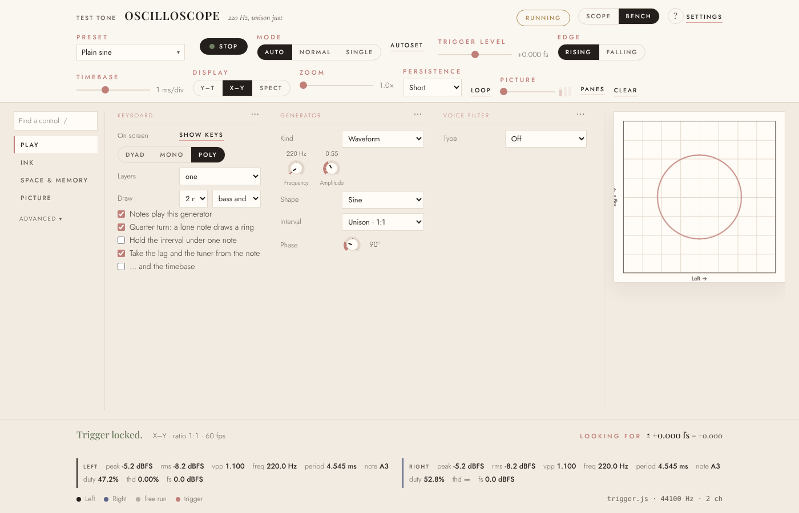

- **The scope's own controls lead.** The top third of every tab is Mode, Autoset,
  Trigger level, Edge, Timebase and Zoom, none of which is needed to play. The bottom
  165 px is a readout of peak, RMS, Vpp, duty and THD.
- **The screen is a thumbnail.** On the Bench it is about 280 px, in an instrument
  whose whole point is the picture.
- **What is played is hidden, and what is not is shown.** The amp envelope and glide
  are behind ⋯; the drawbars take a column while saying *Not playing*.
- **It does not fit its own plugin window.** At the plugin's minimum, 960×600, the
  Bench is about 125 px tall and only the Play tab is left in the rail.

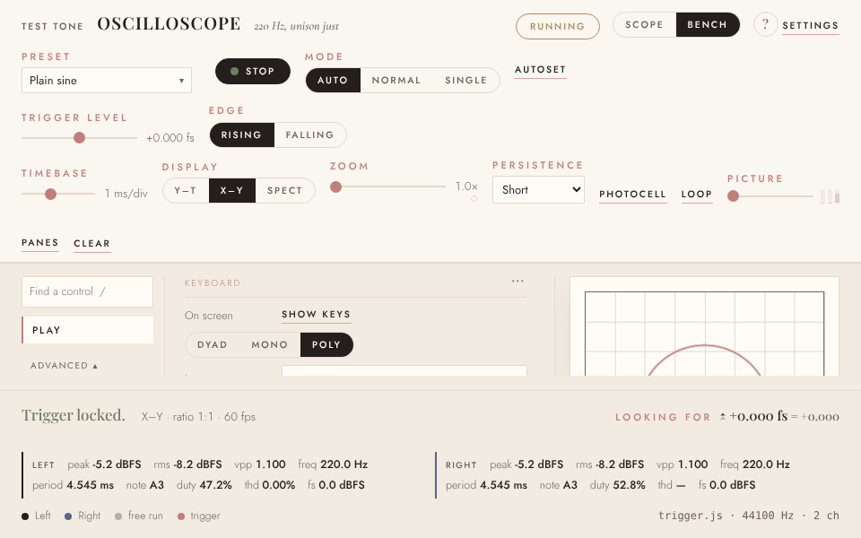

- **Names collide.** *Persistence* is both the screen's menu and a knob under Scan,
  and they are one setting. *Picture* is a tab and a slider. *Bend* is geometry, in an
  instrument about to gain pitch bend. *Test tone* and *trigger.js · 44100 Hz* are
  developer labels left on the face.
- **There are 28 modulation sources:** 9 that hear the sound, 12 that read the
  picture (six of them about the drawings), 3 stage reads, 2 LFOs, level and the
  envelope, and the keyboard's and controllers' besides. Most of the picture's readings
  are near constant on a still picture (*Why nobody reaches for it* in
  `making-it-one-instrument.md` measured them).

## The shape

The screen on the left, as large as the window allows. On the right, the loop's three
tabs. Along the bottom, the Picture: the end of the loop, always in view. Everything
else is a menu or an overlay that opens from where it belongs and closes again.

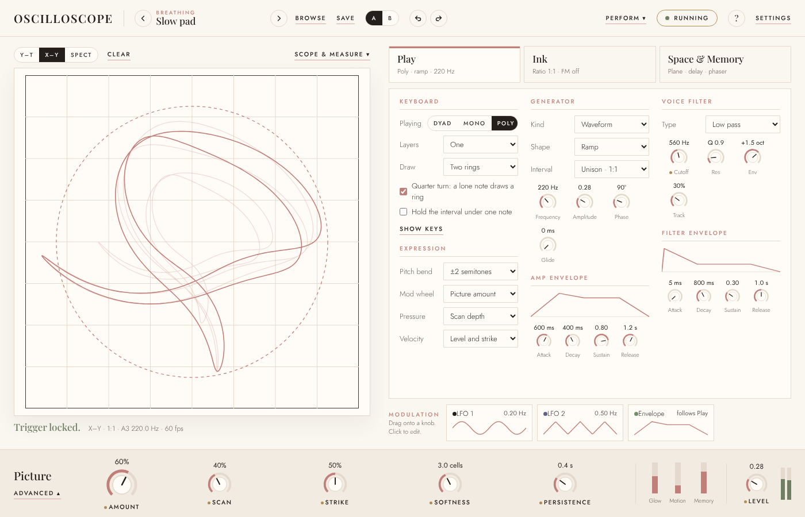

The rules the design holds itself to:

1. **One home for every control.** Nothing appears in two places, so nothing has two
   ids, and no knob has to be kept in step with another. This is *Controls are moved,
   never copied* taken one step further: not even a second view.
2. **Nothing scrolls.** Not a tab, not an overlay. Where a section would crowd its
   tab, a module folds (the effects) or a column greys rather than grows (the
   drawbars).
3. **The picture stays in view while it is being changed.** The tabs, the Picture's
   Advanced panel and the modulation editor all sit to the right of the screen or
   below it. Presets and Settings may cover it, because neither is played.
4. **Sound and look are told apart.** A control that only changes how the screen looks
   says so where it sits; a measurement control that reaches the speakers says that.
5. **The DAW's knobs are marked, not collected.** A small gold dot (`--gold`, the
   house's marker) beside a control means it is a host parameter. There is no strip of
   copies.

## The regions

### The header

Left to right: the name; the preset, with previous and next arrows that step through
the bank without opening anything, its heading above it in the eyebrow style, and
*Browse*; *Save*; an **A/B** compare; undo and redo; then, at the right, *Perform*, the
run status, help and *Settings*. Undo, redo and A/B are new.

### The screen, and Scope & measure

Above the screen: Y–T / X–Y / Spect, *Clear*, and *Scope & measure*, which opens the
oscilloscope's own tools over the screen. Under it, the verdict line (*Trigger
locked.*) and one line of facts. The readouts move into Scope & measure, off by
default.

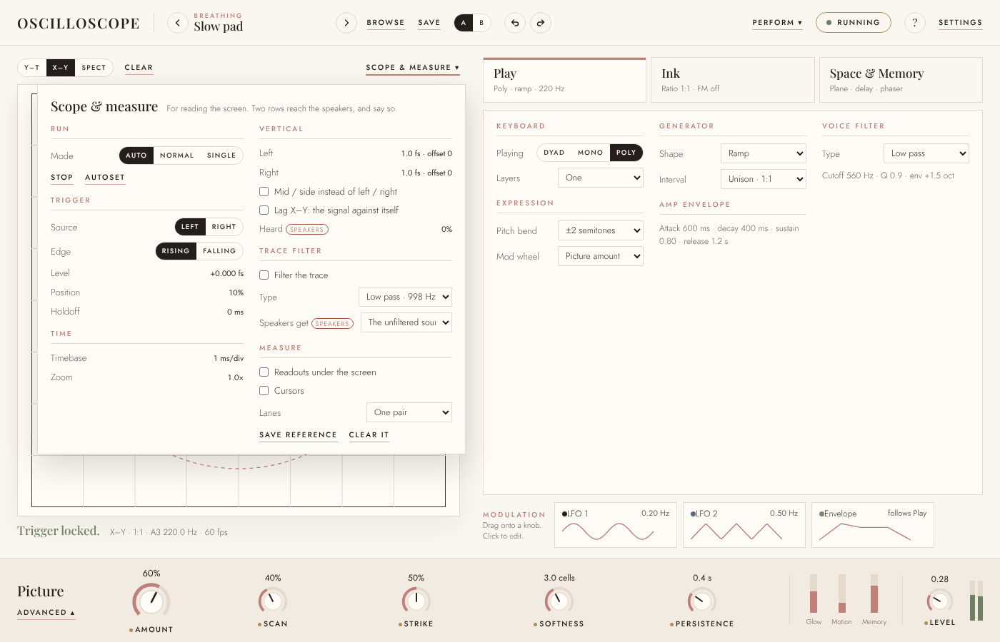

Run (mode, Stop, Autoset), Trigger (source, edge, level, position, holdoff), Time
(timebase, zoom) on the left; Vertical, the trace filter and Measure (readouts,
cursors, lanes, saved reference) on the right. Two rows reach the speakers, and each
carries a small *speakers* tag in `--rust` as the house's "outside": Lag X–Y's
*Heard*, and the trace filter's *Speakers get*. Hiding either as measurement would be
a lie about what it does.

### The three tabs

Play, Ink, Space & Memory, in the order the sound goes round the loop. Each tab is a
card with its name and one line of what that stage is doing now (*Poly · ramp ·
220 Hz*), so the face can be read without opening a tab. The selected tab takes the
house's inset 3 px rule at its top. No arrows between them and no verbs: the order says
it.

**Play** is what your hands do: Keyboard (Dyad / Mono / Poly, layers, what is drawn,
the quarter turn, holding the interval, the keys on screen); **Expression**, which is
new (pitch-bend range, and what the mod wheel, pressure and velocity are wired to, by
default the Picture amount, Scan depth, and level with strike); the Generator with its
amp envelope on show; and the voice filter with its own envelope. It is the fullest
tab.

**Ink** is what the beam is drawn with: the oscillator (ratio, FM, Warp, Warp at,
Ring, Sync, Sub), unison, shaping (drive, fold, crush), the drawn cycle and the
drawbars. The drawbars and the drawn cycle are greyed until their shape is chosen,
rather than hidden, so the columns never jump.

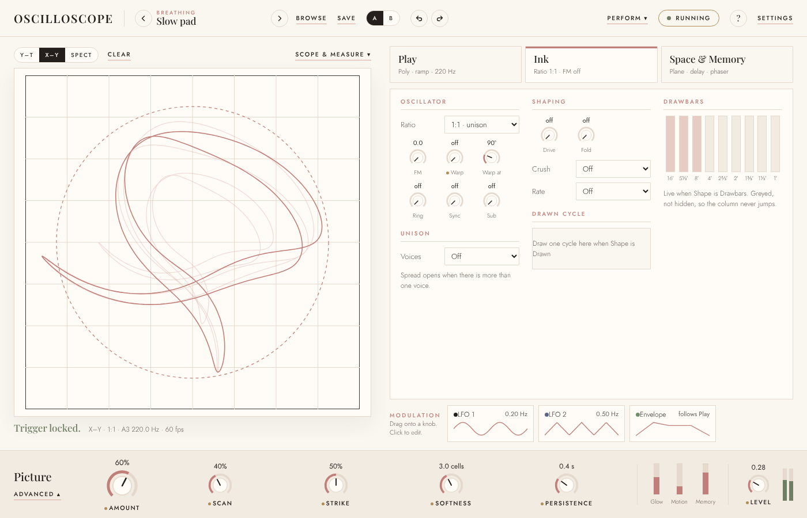

**Space & Memory** is the effects, as a rack.

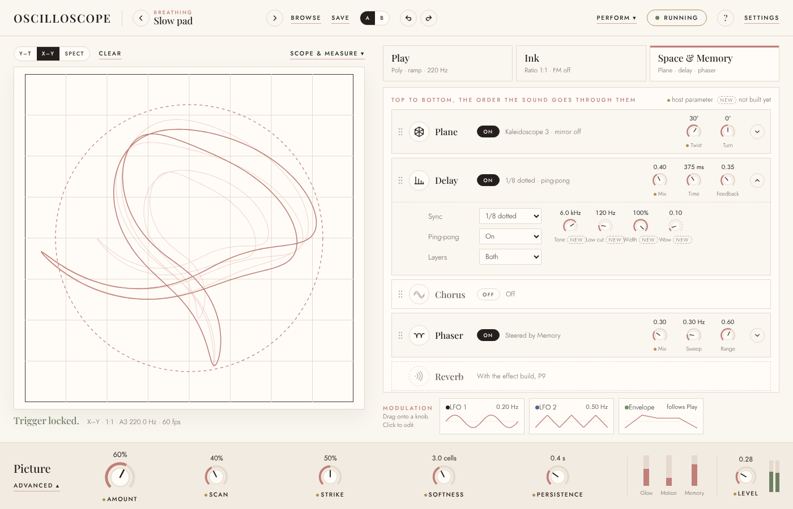

- **Top to bottom is the order the sound goes through them**, and they can be
  reordered by their handles. Order is part of the loop here, not a mixing detail:
  every effect acts on the X–Y pair, so twist-then-delay and delay-then-twist draw
  different pictures, which Scan then reads differently.
- **Each effect has an icon** in a small circle, greyed when it is off: Plane, a
  hexagon with its mirror lines; Delay, repeats getting shorter; Chorus, two waves a
  little apart; Phaser, a line with notches swept out of it; Reverb, arcs spreading.
- **A module shows its main knobs; its arrow opens the rest**, one module at a time,
  so the tab never scrolls. An effect that is off folds to one line.
- **Echo is now Delay**, and the knob that sets how much is heard is *Mix* in every
  module, rather than the effect's own name.
- **Reverb** is a dashed slot, for the effect build (P9). The plan's first rule puts
  it there: it is welcome once the screen hears it. *Built 9 Nov* as the last
  module, always last: two identical networks, one per channel, so at Spread
  nought the figure survives its own tail, and Spread opens it into an
  ordinary stereo tail from other taps of the same network.

Delay's open state shows four controls marked *new*: Tone (a high cut on the repeats),
Low cut, Width and Wow. They are the standard delay controls the current one lacks;
each is page, core and parity work. If only one is built, it should be Tone, since
darkening repeats are what make a delay sound like one rather than a copy.

Repeating an effect (two delays) was considered and deferred. It turns a fixed set of
fields into a list in the setup code (*A field that stops having one answer becomes a
structure* in `CLAUDE.md`), gives every parameter and modulation destination an
instance id, cannot be followed by host automation once slots come and go, and breaks
*nothing scrolls* without a cap. Reordering gets most of the value for none of that.

### Modulation

Under the tabs, a row of three cards, each drawing its shape at a glance: LFO 1, LFO 2
and the Envelope. **Drag a card onto a knob** to put it there; **click it** to open its
editor above the row.

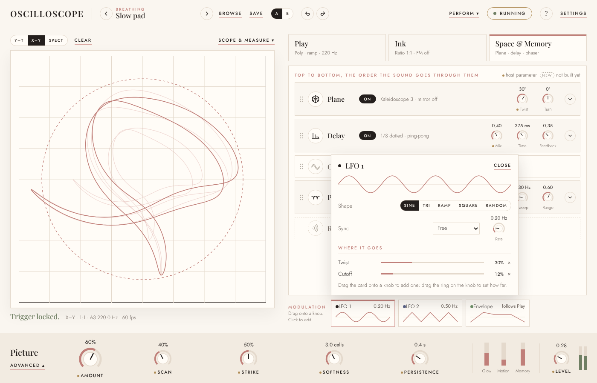

An LFO's editor holds its shape, sync and rate, a large preview, and *Where it goes*:
each destination with its depth and a ✕. The Envelope's says what it is, because it is
not an envelope of its own: today's *Envelope* source follows the amp envelope on Play.
A separate modulation envelope, with its own attack, decay, sustain and release, would
be new; it earns its place if the filter and the picture should move on different
timings. *(Built 8 Nov: ticked in the Envelope's editor, the card has an envelope of its
own, one for all the notes held, with the legato rule; unticked it follows Play.)*

**Three sources replace twenty-eight.** The hearing family, the drawings' readings and
the six picture readings go. Glow, Motion and Memory stay as they are now, always on
and scaled by the Picture amount, so they are not offered as routable sources too: that
would be a second way to the same thing. The keyboard's sources become Expression's
mappings on Play. Setups and presets that route a removed source need a version-tagged
decode pass, and the old library kept as a corpus (`core/tests/scenarios/library-p8f.json`)
routes many of them, so the suites that open it need a look.

### The Picture

The bottom of the window is the Picture section: the Amount, Scan, Strike, Softness
and Persistence, live meters for Glow, Motion and Memory, and Level with the output
meter at the end. It replaces both the old Picture tab and the strip under the screen.
Persistence appears once; it is the screen's persistence and Scan's, which were always
one setting.

*Advanced* opens the rest over the right side, leaving the screen in view, in two
halves.

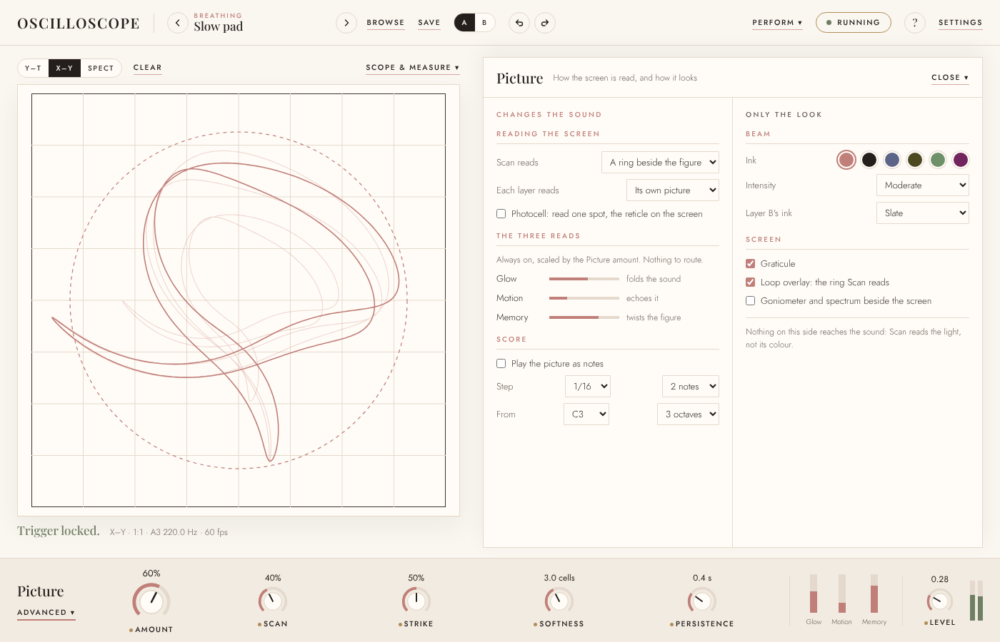

- **Changes the sound:** what Scan reads; what each layer reads; the photocell; the
  three reads, with what each does (Glow folds the sound, Motion echoes it, Memory
  twists the figure); and the score.
- **Only the look:** the beam's ink, intensity, Layer B's ink, the graticule, the loop
  overlay and the side panes. A line at its foot says nothing on this side reaches the
  sound, since Scan reads the light and not its colour.

The look-only half bends the plan's first rule, that a feature acts on the loop. It is
there because the owner wants it for people who use the instrument as a visualiser, and
labelling it honestly is what keeps it defensible. The beam's ink is chosen from the
six lane inks in `DESIGN.md`, which are measured to stay apart on the paper, so it adds
no colour to the brand.

### Perform

A header menu for what is set at the start of a session and played over.

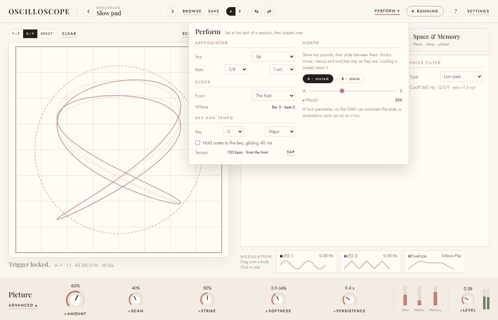

The arpeggiator (mode, rate, octaves), the clock (where it comes from, and where it is),
key and tempo (key, scale, holding notes to the key with its glide, tempo and Tap), and
**Morph**, which moves here from the Measure tab: two slots, A and B, and the fader
between them. Its rules are the cheat sheet's (knobs move, menus and switches stay, a
preset clears it), and it keeps its host parameter.

### Presets

*Browse* opens the bank.

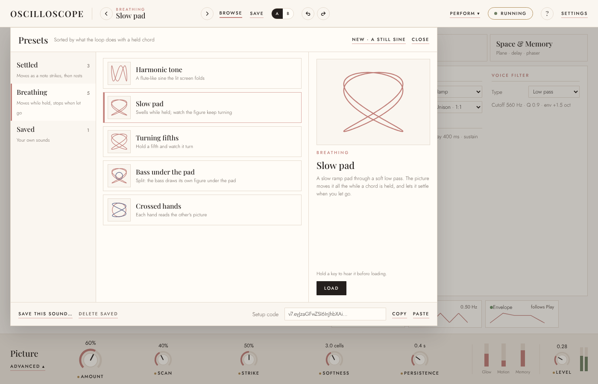

Headings on the left (Settled, Breathing, Saved, each with what it means in a line),
the heading's sounds in the middle, each with a thumbnail of its figure, and the chosen
sound on the right, larger, with its description and *Load*. A split draws its second
figure in Layer B's ink. *New* returns to the base. The footer takes what Settings used
to hold for presets: *Save this sound*, *Delete saved*, and the setup code with *Copy*
and *Paste*. There is no search, with eight presets.

The one-line descriptions in the mockup are paraphrases; every preset already carries a
long one in `PRESETS`, and whether each gains a short *listen for / watch for* line is
the owner's call. *Hold a key to hear it before loading* is drawn and would be new.
*Decided 8 Nov:* the lines, yes - each preset has two, under sixty characters, the
listen line on its card and both over the description on the right; the audition by
a held key, no, since Load, listen and undo already do it.

### Settings

What is set once and left.

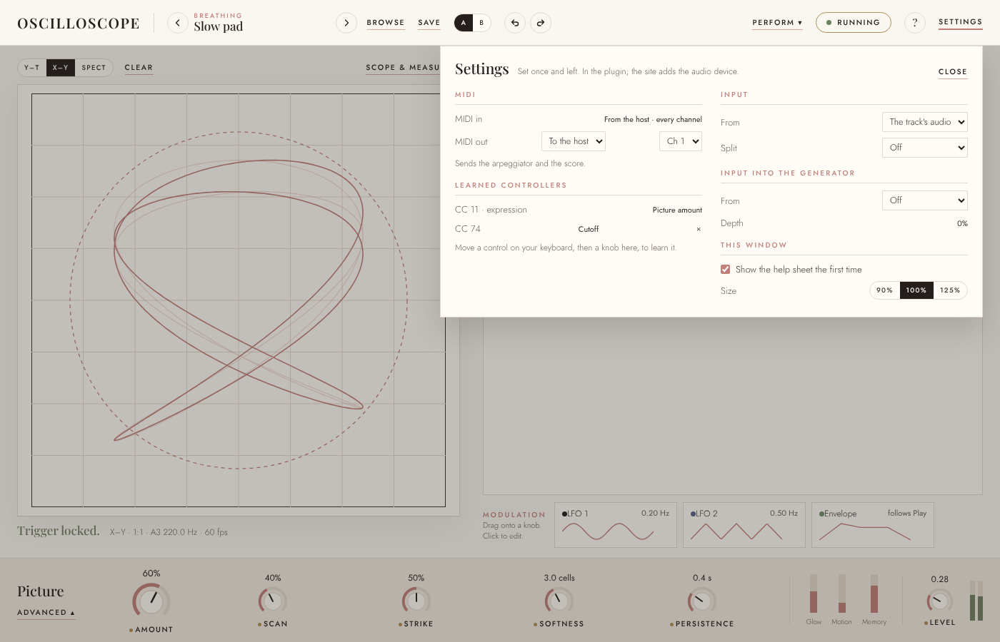

MIDI (in, from the host; out, to the host on a channel, carrying the arpeggiator and the
score; the learned controllers, each with a ✕), Input (where the track's audio comes in,
and input into the generator), and *This window*: whether the help sheet shows the first
time, and a **Size** of 90, 100 or 125 per cent, which is new. The site's Settings adds
the audio device and microphone or line, which in the plugin belong to the host.

### The minimum window

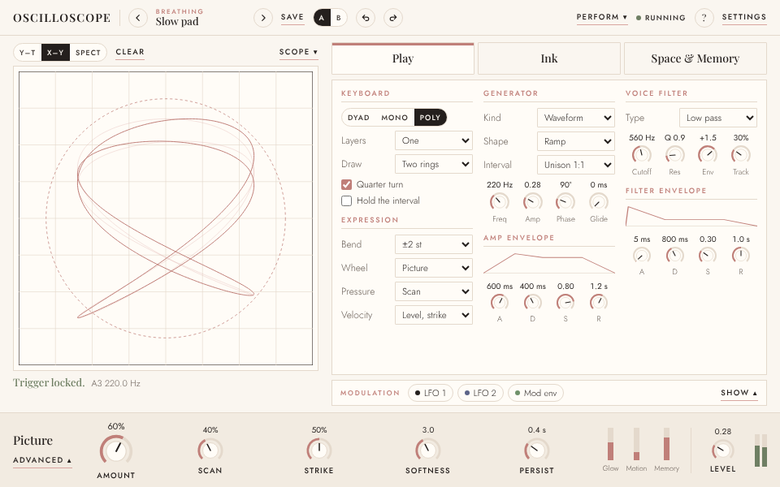

At the plugin's minimum it still fits without scrolling, at a cost: the tabs drop their
summary lines, the envelope knobs are labelled A, D, S and R, menus shrink to about
11.5 px, the screen is about 360 px, and the modulation cards fold to chips. It works,
and it is the tightest the face gets. Two ways to buy room, either or both: the *Size*
setting, and raising the editor's minimum to about 1100×700. The editor's default,
1400×900, is also larger than a 1366×768 laptop and is not remembered; F8 fixes both.
*(Fixed before F8 was built: the plugin opens at 1200×680 and remembers its size. F8 made
the face compact below 1100×860 and added the Size, whose Auto is 90 per cent in the
smallest windows.)*

## Where every control goes

| Today | In the new face |
|---|---|
| Top bar: Mode, Autoset, Stop, Trigger level, Edge, Timebase, Zoom | Scope & measure |
| Top bar: Display (Y–T, X–Y, Spect), Clear | The screen's toolbar |
| Top bar: Persistence menu; Scan's Persistence knob | One control, in the Picture section |
| Top bar: Photocell, Loop | Picture › Advanced |
| Strip under the screen: Picture amount | The Picture section |
| Dock: verdict | Under the screen |
| Dock: the readouts | Scope & measure, off by default |
| Play: Keyboard, Generator, Voice filter | Play, with the envelopes on show and Expression added |
| Ink: Oscillator, Shaping, Drawbars, Drawn cycle | Ink |
| Space & Memory: Display, X–Y rotation | Plane's *Turn* for layer A (layer B's own Turn is already there) |
| Space & Memory: Display, Numbers read | Scope & measure |
| Space & Memory: Plane | The rack's Plane |
| Space & Memory: Delay, chorus and phaser | The rack's Delay, Chorus and Phaser |
| Picture: Scan, Strike, Softness | The Picture section; what Scan reads, in Advanced |
| Picture: Score | Picture › Advanced |
| Drawer, Sources: LFOs | Modulation cards |
| Drawer, Sources: every other family | Cut, or Expression on Play |
| Drawer, Inputs | Settings |
| Drawer, Measure: lanes, vertical, trigger, trace filter, cursors | Scope & measure |
| Drawer, Measure: Morph | Perform |
| Drawer, Perform: arpeggiator, clock, key and tempo | Perform |
| Settings: Audio | Settings (on the site only) |
| Settings: MIDI | Settings |
| Settings: Presets (save, delete, setup code) | The preset browser's footer |
| Settings: Beam intensity | Picture › Advanced |
| Kind menu: the drawings, the second generator | **Open:** back in Kind under a *Drawings* heading, or cut |

## Host parameters

Today's nine are `kKnobs` in `plugin/src/PluginProcessor.h`: picture, scan,
persistence, bend, cutoff, level, echo, phaser, morph. The proposed set is the Picture
section, plus the sound controls people automate:

| Id | Shown as | Change |
|---|---|---|
| `picture` | Picture amount | kept |
| `scan` | Scan | kept |
| `strike` | Strike | new |
| `softness` | Softness | new |
| `persistence` | Persistence | kept |
| `level` | Level | kept |
| `cutoff` | Cutoff | kept |
| `bend` | Warp | renamed on the face; id kept |
| `twist` | Twist | new |
| `echo` | Delay mix | renamed on the face; id kept |
| `phaser` | Phaser mix | kept |
| `morph` | Morph | kept, still in its own group |

Ids stay where the meaning has not changed, so nothing that exists breaks. The owner
has no saved plugin projects, so adding parameters costs nothing now; once projects
exist, the plan's rule that saved automation maps across applies.

## What it changes in CLAUDE.md

| Decision | Here |
|---|---|
| The bench body uses real column elements | Kept |
| A control's appearance does not depend on how many sources are on it | Kept; the cards change how a source is *offered*, not how a knob shows one |
| The Bench's controls are knobs over their range inputs | Kept |
| No Bench tab may scroll | Kept, and extended to every overlay |
| What is not the loop goes in the drawer | **Retired.** The drawer's tabs each go to where they belong (the table above); nothing is left to put in it |
| The Sources tab shows one family at a time | **Retired**, with the families |
| Every section has one home | Kept, and now true of every control |
| Presets are a small bank under two headings | Kept; the browser changes, not the bank |
| Controls are moved, never copied | Kept, and the strip of host knobs that would have broken it is not built |
| The Picture amount and its reads stay in the bar under the screen | **Changed:** the Picture section at the bottom of the window takes the bar's place |

The suites that hold the retired and changed ones (`benchtest.py`, `fittest.py`,
`patchtest.py`) are rewritten against the new rules in the stage that changes them, and
`CLAUDE.md` with them. `knobtest.py` and `designtest.py` should hold as they are; the
*new* tag and the *speakers* tag use existing tokens.

## New work the design depends on

Not layout, and each one page, core and parity work where it touches the sound:

- Pitch bend with a range, channel pressure, the mod wheel's default, velocity's
  mappings (Expression). Queued already, with the rename of Bend to Warp.
- Cutting the modulation sources to three, with its decode pass.
- Effect order, which makes the rack's order a field of the setup code.
- The beam's ink and Layer B's ink. *Built 8 Nov:* the accent and five lane inks as
  swatches, B's as a menu defaulting to its lane's; terracotta left out as the reticle's.
- Undo and redo, and A/B compare.
- The window's *Size*, the editor's size remembered, and its default and minimum.
- Optional: Delay's Tone, Low cut, Width and Wow (*built 8 Nov*); a modulation envelope of its own
  (*built 8 Nov*: a switch and four knobs in the Envelope's editor);
  auditioning a preset by holding a key.

## Stages

Each stage leaves the suite green and the instrument usable, and each is pushed alone.

- **F1 Scope & measure.** The top bar's scope controls and the drawer's Measure move
  into one overlay over the screen; the readouts with them, off by default. The *Test
  tone* and *trigger.js* labels go.
- **F2 The Picture section.** The bottom of the window takes the Picture amount, Scan,
  Strike, Softness, Persistence, the three meters and Level; the Picture tab's remaining
  controls and the top bar's Photocell and Loop go to its Advanced panel; the duplicate
  Persistence becomes one control.
- **F3 Three tabs, no drawer.** Play, Ink, Space & Memory as cards with summaries;
  Inputs to Settings, Perform to the header (with Morph), the envelopes on show.
- **F4 Modulation.** The cards and their editor; the sources cut to three, with the
  decode pass.
- **F5 The rack.** Effects as modules with icons, Delay renamed, one open at a time;
  then order, with its field in the setup code.
- **F6 Presets.** The browser, with thumbnails, and the setup code moved into it.
- **F7 Header and Settings.** A/B, undo and redo, Settings as drawn, the host
  parameters above.
- **F8 The window.** The minimum layout, *Size*, the editor's default, minimum and
  remembered size.

## Open

- **The drawings** (harmonograph, figures, solids, the second generator): back in the
  Kind menu under their own heading, or cut. The plan already questions whether they
  belong.
- **Plane's controls.** The owner's notes propose removing Kaleidoscope and Snap below
  five bits; the mockup shows today's controls, and the module loses those rows if that
  lands first.
- **Look-only settings beyond ink.** Which, if any, are worth building is the owner's
  call.
- ~~**Short preset lines** (*listen for / watch for*), and whether auditioning by holding
  a key is built.~~ *Decided 8 Nov:* the lines and not the audition. Built.
- ~~**The minimum window:** the *Size* setting alone, or a larger minimum as well.~~
  *Decided 8 Nov:* the setting alone, with an Auto that is 90 per cent under 1100×680,
  so the minimum stays 960×600 and fits without anyone choosing. Built in F8.
