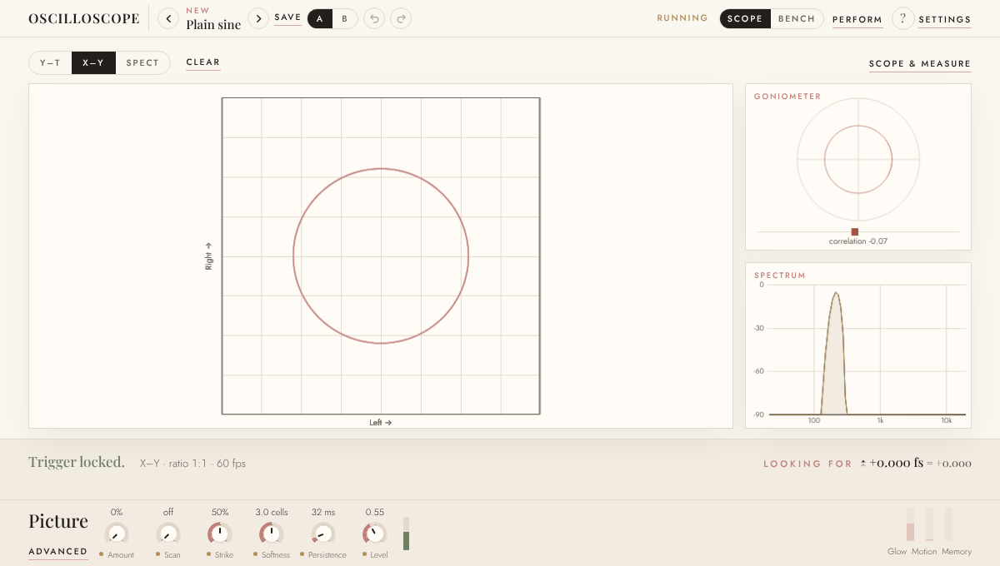
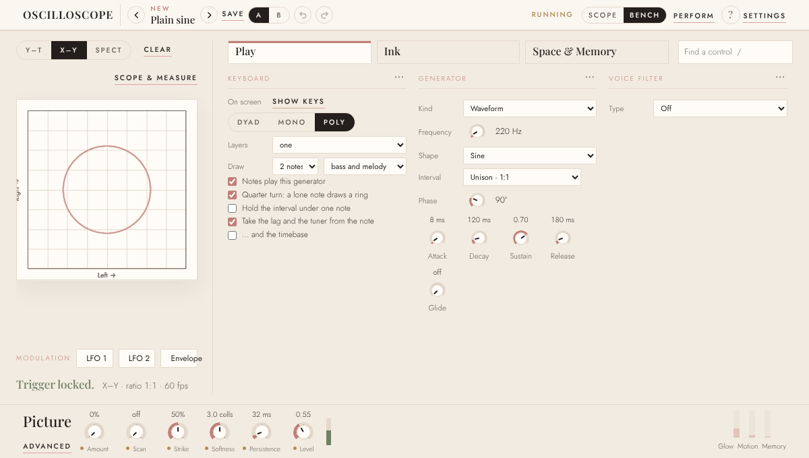
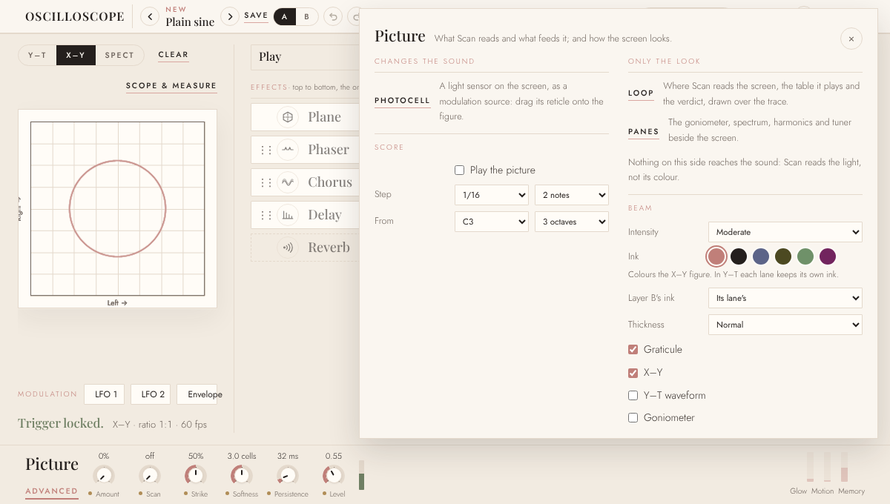
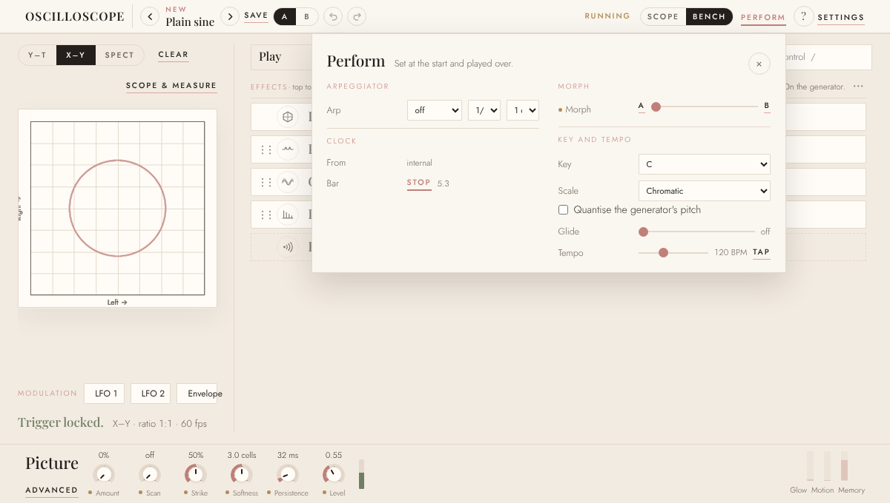
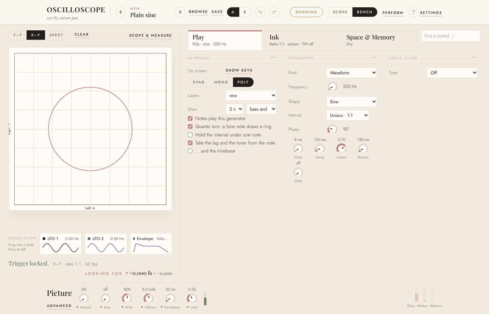
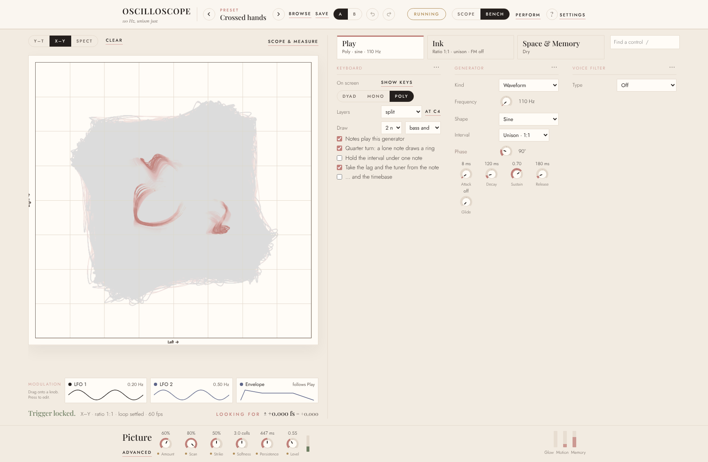

# The second review

An outside review of the instrument on 9 November 2026, at `1519f0b`, two weeks after the
first and after the face's first pass (F1–F8) and the work on the plugin that followed
it. It was asked the same five questions as the first: what the instrument lacks against
other synthesisers and plugins; what code is dead, redundant or more complicated than it
needs to be; what the plugin does right and wrong; how the face could be laid out better;
and whether each hand of a split can have its own picture settings.

How it was done: the code read again, the face captured at the plugin's default window
(1200×680), at 1400×900 and at 960×600, and two independent audits, one of the page's
script and one of the C++ core and the plugin, each measuring rather than reading where
it could. Findings marked **(checked)** were confirmed in the code by the reviewer; the
rest are the audits', with their evidence.

*What has been decided since* is at the end. The brief for the face that answers parts 4
and 5 is `the-face-second-pass.md`.

## In short

The face's first pass landed, and the three state bugs the first review found in the
plugin are fixed and tested on sound. What remains: the face seen at the plugin's normal
window is not quite the one designed; about 1,300 lines of parked code still run or ship;
and there are a handful of new bugs, three of which lose or misplay sound.

## 1. Against other synthesisers and plugins

Closed since the first review: pitch bend with a range, the mod wheel and channel
pressure; undo and redo; a preset browser; the order of the effects; a full delay; a
modulation envelope that can start again on every note; the bank as the host's programs;
a tail that follows the delay; and fixed 128-sample steps, so the sound no longer depends
on the host's buffer.

Still missing, most important first:

1. **Most controls cannot be automated or played from a controller.** Twelve parameters
   reach the host and MIDI learn was cut. The delay's time, the LFOs' rates, Strike and
   the filter's resonance cannot be automated; in Serum, Vital or Pigments everything can.
   It was a choice, and the largest gap left for someone in a DAW.
2. **Moves on the face reach the host without a change gesture,** so touch and latch
   automation do not record them.
3. **Smoothing is per block,** not per sample: at host blocks of 128 or fewer there is
   none, and the level and the cutoff can zipper.
4. **No MPE and no polyphonic aftertouch;** MIDI channels are merged.
5. **Tuning is fixed at A440,** with no scale files or MTS-ESP.
6. **No latency is reported,** though the plane's oversampling adds about 32 samples when
   it is on.
7. **No CLAP.**
8. **7–17% of a core per instance** with two notes held at 48 kHz, of which about five
   points is the parked hearing (part 2).

The reverb was being built during the review and is not counted.

## 2. Dead code, redundant code, complexity

Taking things out of the face mostly left them in the code: the page grew 7% (its
stylesheet 36%) across a stage that retired the drawer, the Sources tab and twenty-five
sources.

- **Parked, still running (checked).** The hearing family runs a 4096-point FFT whether
  or not anything routes it: about 375 times a second in the plugin, costing about five
  points of a core on the plain sine, and about 2 ms of every frame on the page. Nothing
  on the face reads it. It should run only when a hearing source is routed.
- **Parked, still shipped.** The drawings - about 1,300 lines of figures, a stroke font,
  wireframes, their editors and their rows - cost nothing until chosen, but every change
  carries them. (Since decided: removed. See the end.)
- **Dead or orphaned:** 24 elements fetched and never read (13 at the first review);
  about 30 CSS rules, 130 lines, matching nothing (the Sources tab's, the old chips', the
  colophon's); `SIDE_GROUPS = []` still tested in four places, `railTabs`, and a search
  loop over the hidden transport row; from the first review, still there: `destOptions`,
  `trigGain`, and `hannOf` (a Blackman-Harris window under a Hann name). Pressure and
  pedal smoothing still run on the page, and the level follower and pressure smoothing in
  the core, for sources that were cut. `setLfoDest`, `setLfoDepth`, `lfoRouting`,
  `armSource`, `clearSource`, `benchable` and `beatRate` have only tests for callers.
- **Redundant:** `snapshot` and `restoreInto` still list every setup field by hand,
  guarded by the schema's test now; `jsMathRound` repeats `jsRound`; the loop that drops
  cut routings is written out three times in `setup.h`; `restore.h` is still 2,039 lines.
- **Complexity that crept in:** undo watches by polling, encoding the whole setup about
  eight times a second for ever, where change events would do; two systems of size, the
  compact face in the page's zoomed pixels and the older width rules in the screen's;
  and three different "A/B"s - the header's versions, the morph's two sounds, and the
  layers' *Edit A / B*.

## 3. The plugin, right and wrong

**Right:**

- The first review's three state bugs are fixed and tested on sound: a host's re-prepare
  keeps the sound, a save before the first block writes the waiting state, and a save no
  longer silences a block.
- Host automation moves only the knobs it moved rather than reloading the face.
- The MIDI output flag matches what the plugin produces.
- The new delay, phaser and envelope are safe on the audio thread.
- The schema generates the core's list of fields and is in step; parity covers all six
  orders of the effects.
- The host's parameters match the page's, id for id and in order, with stable ids.
- 2,524 checks pass.

**Wrong:**

1. ~~**The plugin opens at 960×600 every time (checked).**~~ Fixed 9 Nov: the editor
   reads the remembered size, or the 1200×680 default, and sets it before
   `setResizeLimits`, which can then clamp nothing (`PluginEditor.cpp`, where the comment
   says why). `setResizeLimits` runs before
   the remembered size is read (`PluginEditor.cpp:113`, `:115`); in JUCE that resizes the
   empty editor up to the minimum, and `resized()` saves 960×600 over the stored size. The
   1200×680 default and the remembered size are never used. Reading the size first fixes
   it; no test builds an editor.
2. ~~**The delay replays old audio when it is turned back on (checked).**~~ Fixed 11 Nov:
   a module switched on starts from silence, the delay, chorus, phaser and reverb alike,
   on both hands, page and core (`timeRuns`; web/README.md says what was rejected). The
   line was written only while the mix is above nought (`plane.h`), so turning it on
   played the moment it was turned off, with its old feedback. The site had it too.
3. ~~**Turning a module back on can bring back an earlier preset's settings (checked).**~~
   Fixed 11 Nov: what a switch kept is kept per hand and forgotten by anything that goes
   through `restore`, and undo's steps carry it. `fxKept` remembered a module's mix when
   it was switched off and was never cleared: switch the delay off, load another preset,
   switch it on, and it came back at the first preset's mix. The Plane brought back all
   of its shaping and its turn, and the upper hand's own delay's mix came back on the
   lower's.
4. ~~**The Photocell cannot be routed, though the face says it can (checked).**~~ Fixed
   10 Nov (G5a): it is the fourth card in the modulation row, offered wherever the LFOs
   and the Envelope are, and patching from its card switches it on, which lands its
   reticle on the figure. Checked again for G8 (11 Nov) on the site's compiled
   instrument: patched to the frequency from its card, it took a held 220 Hz to 280 Hz
   with the slider unmoved; the cheat sheet's and the editor's claims about it are true.
   Only the two
   LFOs and the Envelope are offered, but Advanced calls it "a light sensor... as a
   modulation source" and the cheat sheet tells you to use it like an LFO. Turned on, it
   changes nothing heard.
5. **Every audio block allocates,** even a steady one: about 32 allocations and 138 KB a
   block, mostly the capture and the voice budget.
6. **The program's number is not saved,** so a reopened project shows the wrong one.
7. ~~**The morph also slides the screen's settings:**~~ Fixed 11 Nov (G8): the morph
   leaves the scope's view alone - the timebase, the zoom and the trigger's level,
   position and holdoff (`MORPH_SKIP`, `kMorphIds`) - and the preset glide, which walks
   the same list, lands a preset's view at once. The tempo stays in it, the owner's call:
   it is heard. So do the trace filter, the AC corner and the lag, which are in Scope &
   measure but change the signal Scan reads and the speakers get on Shaped.
   `setupmorphtest.py` and parity hold it. The timebase, the trigger level, the
   zoom, the tempo and more.
8. ~~**Stale text on the face (checked):**~~ Fixed 11 Nov (G8): the cheat sheet, Perform's
   and the keyboard's notes say where each thing is now, and `wordstest.py` reads every
   word the page can show - text, hidden panels, tooltips, the info line, the sources'
   descriptions - for a tab, view or drawer that has gone. Before, it found six. "the
   Picture tab" in the cheat sheet, "the
   Sources tab" in Perform's note.

## 4. The face

At the plugin's default window:

1. **It opens on the Scope view (checked):** the goniometer, the spectrum and *Looking
   for +0.000 fs*. The first thing someone sees in a DAW is a measuring instrument.
2. **The plugin's normal window gets the compact face.** The face is compact below 860 px
   tall, so at 1200×680 the tabs lose their lines and the cards their waves; the face as
   designed shows only on large screens.

   

3. **The screen is small for the centre of the instrument:** about 250 px at 1200×680,
   with about 100 px of nothing under it, while Play's third column is often empty.
4. **The Picture section reads as a status bar:** six small knobs to the left, the three
   meters far to the right, nothing between.
5. **Picture's Advanced covers the header,** Running, Bench and Perform included.

   

6. **Standard controls are hidden:** pitch bend's range and what the wheel and pressure do
   are behind the Keyboard's dots.
7. **Cut off and misread:** *2 n* and *bass and* on Play, *1/* and *1 o* in Perform's
   arpeggiator, *Envelope follo…* on its card, and Glide's *off* under *Attack*, so it
   reads *Attack off*.

   

8. **The search looks like a fourth tab,** the same width and in the same row.

At 1400×900 the drift from the first brief is plainer: the controls fill the top of the
tab and the rest is empty.

## 5. Each hand's picture, and the header's A/B

It is impossible today, and the code already has the shape to fix it. Layer B has its own
copy of about sixty settings - the voice, the filter, the envelopes, the oscillator, the
effects and Scan's depth - but not the Picture amount, Strike, Softness or Persistence.
The schema's twin fields, where empty means "the same as A", fit a per-hand amount
exactly, with no migration for old codes.

What makes it confusing today is that the switch for which hand you are editing is in
pieces (checked): *Edit A / B* on Play's Keyboard, a *Together / A / B* on the Plane and
another on the delay, and the Picture section's Scan quietly follows Play's switch while
the Amount, Strike and Softness beside it do not.

The header's versions A/B can go: undo, the saved presets and the morph cover comparing,
and it is one of three "A/B"s. In its place, one selector for which hand you are editing,
shown only with layers on, which every tab and the Picture section follow; the morph's
two sounds become *From / To*. (Since refined with the owner into a selector plus a link
on each section: see `the-face-second-pass.md`.)

## Found after the review: the wash

The owner's Crossed hands showed a pink wash over the whole screen, playing or not, and
the axis labels written over each other. Reproduced and measured: the screen's fade stops
short of the paper at low persistence and stains it, and the labels, drawn into the same
canvas, stain with it. The cause, the measurements and the fix are in
`the-face-second-pass.md`, under *The wash*.

## What has been decided since

- **The drawings are removed,** not parked to 22 November: the owner does not miss them.
- **Level is the Generator's,** per hand, and a master **Output** is added.
- **The face's second pass** - the modulation row with the Photocell as a card, drawn
  editors and Routings; the header's hand selector and a link per section; Enlarge with
  *Picture only*; Play rebuilt as drawn; the wash - is `the-face-second-pass.md`,
  stages G1–G8.

## Suggested order

1. The bugs that lose or misplay sound: the window's size, the delay's line, the rack's
   memory; the wash; the Photocell offered or openly parked; the stale text.
2. The hearing run only when something routes it.
3. The face's second pass, G1–G7.
4. The plugin's remaining host work: change gestures, per-sample smoothing of the level
   and the cutoff, no allocation per block, the program's number saved.
5. The dead code alongside the drawings' removal.
