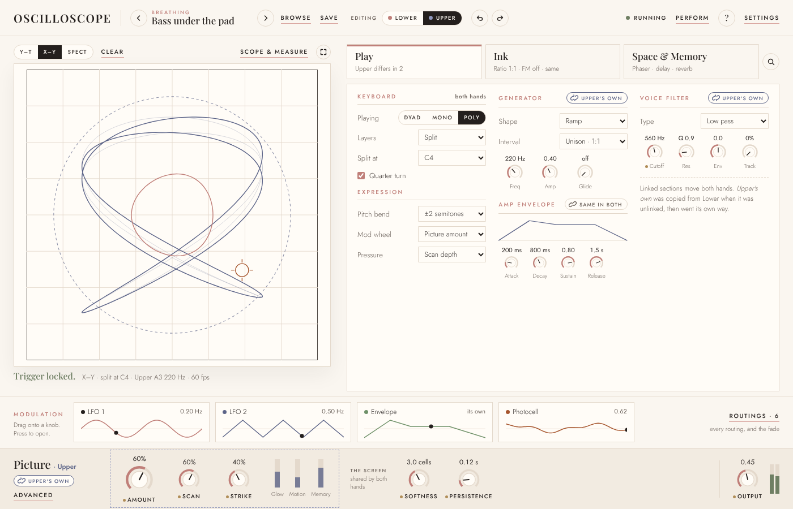
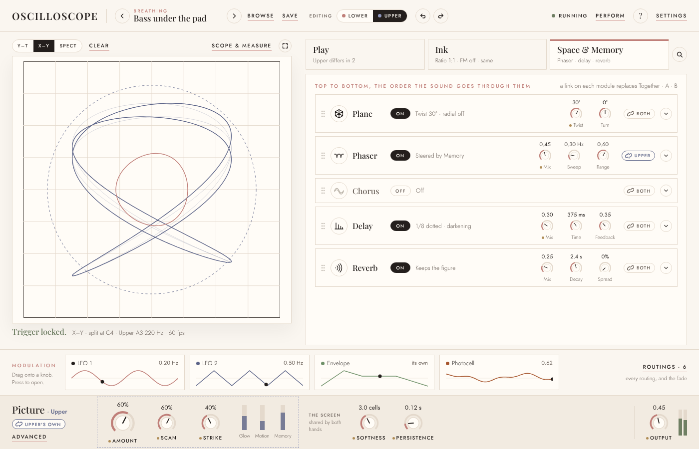
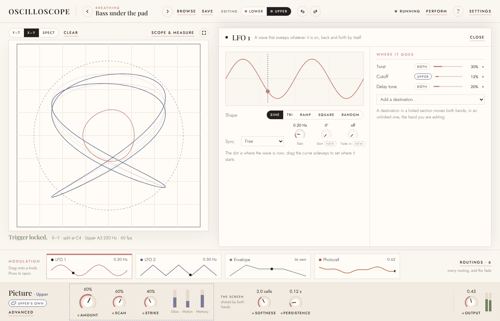
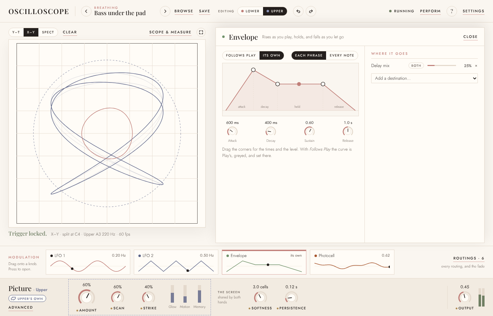
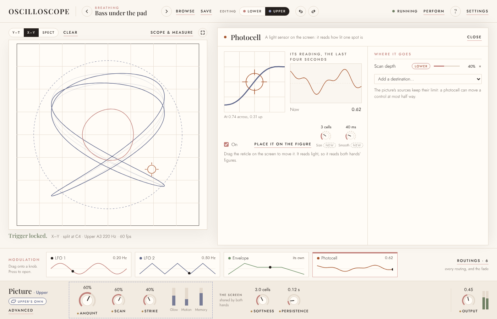
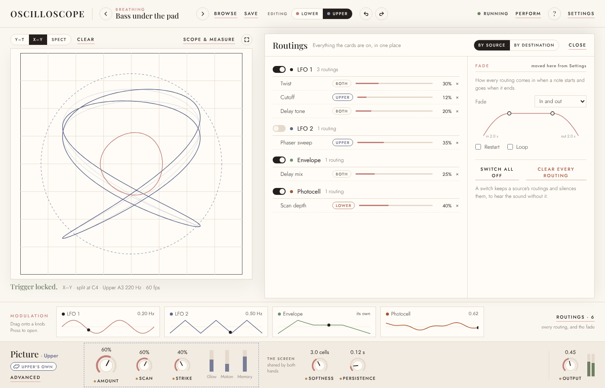
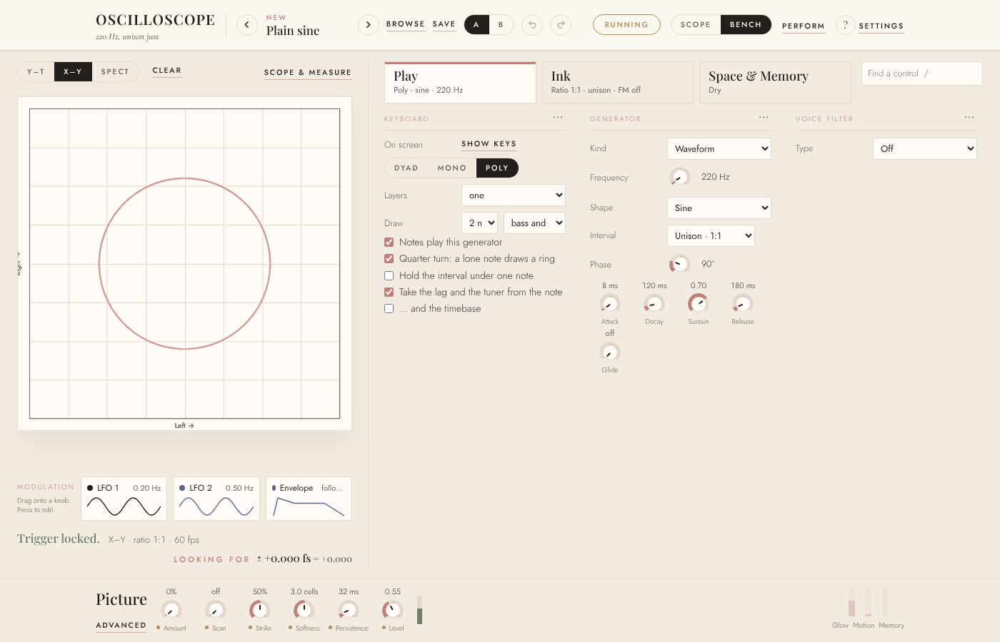
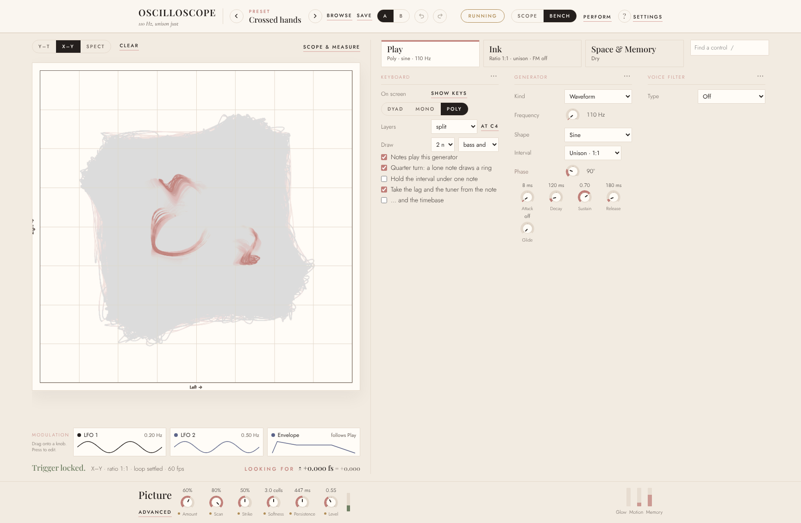
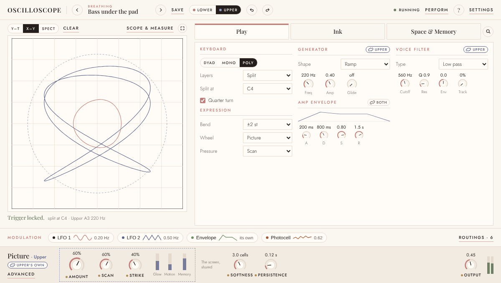

# The face, second pass

A design, not built. It is the brief for the stage after the reverb: the face's second
pass, agreed with the owner from mockups on 9 November 2026, after the second review
(`second-review.md`, beside this). The first pass is `redesigning-the-face.md`; this one
keeps its rules and changes four things about the face, fixes one bug that is in the
picture rather than the sound, and decides two questions that were open.

The mockups are on the design canvas, *Plugin face layouts*
(<https://claude.ai/artifact/RAFomAR8wVnpHHLxMndTSS>, private to the owner until shared),
in the row headed *Modulation across the window, and each hand's own settings*; the
pictures here are rendered from it. Stages are **G1–G8**.

## What changes, in short

1. **Modulation is a row across the whole window,** under the screen and the tabs, with a
   card per source that draws the source itself, and a *Routings* button in its corner.
2. **The Photocell is a modulation card.** Today it can be switched on but not routed.
3. **Each hand can have its own settings, section by section.** One selector in the header
   says which hand you are editing; a link on each section says whether that section is
   the same in both.
4. **Enlarge** shows the screen on its own, and can show the picture with nothing over it.
5. **Play is rebuilt to the drawing** it was meant to follow, and the rows that drifted
   into it go where they belong.
6. **The drawings are removed** (decided 9 Nov): the harmonograph, the figures, the solids
   and the second generator.
7. **Level becomes the Generator's,** and a master **Output** takes its place in the corner.
8. **The wash is fixed:** the screen's fade stops short of the paper and stains it.

## The face

### The header

The versions *A / B* go: undo (a hundred steps), saved presets and the morph's two
stored sounds already cover comparing, and it was one of three different "A/B"s on the
face. In its place, shown only when *Layers* is *Split* or *Layer*: **Editing: Lower ·
Upper** (or *A · B* when layered), each with its figure's ink. The *Scope / Bench* views
go too; *Enlarge* replaces the Scope view (below), and the panes it showed (goniometer,
spectrum, harmonics, tuner) show beside the screen when they are switched on in the
Picture's Advanced.

### The hands

A **link** on each section's title, shown only with layers on: *Same in both* (closed
chain) or *Upper's own* (broken chain, in that hand's ink).

| Where | Sections with a link |
|---|---|
| Play | Generator, Amp envelope, Voice filter. The Keyboard has none: it is both hands by nature |
| Ink | Oscillator, Shaping |
| Space & Memory | Each module, in place of today's *Together · A · B* switches and B's hidden turn |
| The Picture section | One link for Amount, Scan and Strike. Softness and Persistence stay shared: they are the screen's |

Linked, editing either hand edits both. Unlinking copies the hand you are on into the
other as its start, then they go their own ways. A new split starts with everything
linked. The tab cards' lines say what differs (*Upper differs in 2*). A routing follows
its destination's section: on a linked section it moves both hands, on an unlinked one
the hand you are editing, and its row in the source's editor says which (*Both*, *Upper*,
*Lower*).

This fits what is stored. The schema's twin fields already mean "empty is the same as
A": linked is an empty B value and unlinked an explicit one, so codes that already store
B values load as unlinked and need no migration. New twins: the Picture amount and
Strike. Fields that are always separate today (B's shape, level and the rest) become
twins; their stored values are explicit, so they keep meaning what they meant.

### Space & Memory

The rack as built, with a link on each module beside its arrow, and the reverb as a
module of its own (Mix, Decay, Spread; Spread at 0 keeps the figure, as agreed).

### Modulation

A row across the window under the screen and the tabs: a card per source, each drawing
what it is doing with a dot where it is now, *Drag onto a knob · press to open* at its
left, and **Routings** with its count in the right-hand corner. Under the compact size
the cards fold to chips, each still with a small drawing of its shape.

Four sources: **LFO 1, LFO 2, the Envelope and the Photocell**. The row has room for more,
but the cut from twenty-eight to three happened because forty chips read as a wall, so it
stops at about six, and a source earns a card by acting on the loop. Glow, Motion and
Memory stay off it: they move the sound with nothing routed, and routing them as well
would be a second way to the same thing. CLAUDE.md's *Three modulation sources, a card
each* changes to say so.

A card opens its editor over the tabs, leaving the screen in view. Each draws the source
itself; its right-hand column is always *Where it goes*.

**An LFO:** the wave, large, with a line and a dot where it is now; Shape, Sync and Rate
under it. *Start* (where the wave begins) and *Fade in* are new and optional.

**The Envelope:** *Follows Play / Its own* and *Each phrase / Every note* along the top;
its curve with corners to drag and a dot where the phrase is; the four times under it.
Following Play, the curve is Play's, greyed and set there.

**The Photocell:** what it sees, a close crop of the screen around its reticle; a graph of
its last four seconds; its value now; *On*; and *Place it on the figure*. The reticle
still drags on the screen. *Size* (how much of the screen it reads) and *Smooth* are new
and optional. It keeps the picture's limit: it can move a control at most half way.

**Routings**, from the row's corner (not called Settings, which the header has): every
routing, by source or by destination, each with its depth and ✕, and a switch per source
that silences its routings without losing them. The **fade** moves here from Settings with
its Restart and Loop, as the one setting that acts on every routing.

### The Picture section

Amount, Scan, Strike and the three meters in a group with the hand's link, titled
*Picture · Upper* while you edit the upper hand; Softness and Persistence beside it, under
*The screen, shared*. **Level moves to the Generator** (below), and a master **Output**
takes the corner. *Advanced* keeps what Scan reads, the score and what each hand's picture
moves (from Play); it loses the Photocell switch to the card.

### Level and Output

The Picture section's *Level* has never been a master volume: it is the generator's
amplitude (`amp`, with layer B's `bAmp`), so it is per hand. It moves into the Generator
section, linked with it. The corner gets a true **Output**: one level after everything,
shared by both hands, and new. Host parameters: `level` keeps its id and its meaning (the
generator's level, both hands while linked); `output` is added. No projects are saved
yet, so this costs nothing now.

### Enlarge

A button at the end of the screen's toolbar fills the window with the screen (Esc to come
back), with one switch, **Picture only**, on by default there. It hides everything drawn
over the trace: the photocell's reticle, the loop overlay (Scan's ring, its read-head,
table and badge), the hand's mark, the axis labels, the verdict and readouts, and the
graticule if wanted. All of these are on layers of their own, so hiding them changes
nothing heard. Two choices that only the enlarged view needs, both look-only and labelled
so:

- **Which hands:** *Both · Lower · Upper*. In Crossed hands the two figures and their long
  trails pile into one cloud; one at a time, each can be seen.
- **Trail:** a shorter trail for the display only. It shows less than Scan is reading,
  which a visualiser can accept and the instrument's normal face should not.

## Play, as drawn

The built Play tab drifted from the first brief: Expression went behind the Keyboard's
dots at every size, the amp envelope is four knobs under the Generator with Glide wrapped
beneath Attack (so it reads *Attack off*), the filter's column is empty while it is off,
and the Keyboard holds rows that are not the keyboard's.

Three columns, as drawn:

1. **Keyboard**, then **Expression** on show (pitch-bend range, mod wheel, pressure,
   velocity). On the compact face Expression may fold behind the dots; above it, never.
2. **Generator** (Kind, Shape and its own rows, Interval, Tuning, Level, Glide beside
   Shape), then **Amp envelope** with its curve.
3. **Voice filter**, then its envelope. Off, its controls show greyed, as the drawbars do,
   rather than leaving a third of the tab empty.

At large windows the face grows: the screen to its column's height, and the row and the
verdict under it rather than pinned to the bottom of the window. Menus that are cut off
today (*2 n*, *bass and*, Perform's *1/* and *1 o*) get their room.

## The wash

The screen fades by painting the paper over itself each frame at the persistence's
strength. Below about 0.1 a frame's step is less than half of one 8-bit step before the
paper is reached, so it rounds to nothing and the pixel stops: measured on a bare canvas,
a rose, a slate and a grey trace all stop at grey 220 at Crossed hands' 0.0255 and never
move again, and at 0.12 (Slow pad, Turning fifths, Bass under the pad) a faint stain stays
(248, 248, 240 against the paper's 255, 252, 247). The axis labels are written into the
same canvas every frame (`scope.html:18378`, `:18383`), so a label from before - *Right →*
under *A · X, B · X* - never leaves either: the overlapped wording.

The sound is untouched (Scan reads the phosphor grid, which fades in floating point), but
the screen then shows a picture Scan is not reading. The fix:

1. **The axis labels and the graticule on a layer of their own,** as the loop overlay is.
2. **A fade that reaches the paper:** at low persistence, fade every few frames by the
   equivalent larger step, or keep the trace in a full-precision buffer.
3. **A test against the failure:** paint ink, run ten seconds of fades at 0.0255, and
   require the pixel within 2 of the paper. It fails today; null-test it against the
   current fade before trusting it.

## Removing the drawings

Decided on 9 November, ahead of the date the plan set for it: the owner does not miss
them. Out go the harmonograph, the figures (shapes, text, SVG paths, the drawn figure),
the wireframe solids and the second generator; their rows (Figure, Words, SVG, Draw,
Detail, Solid, Spin X, Y and Z, Spin rate, Perspective, Trace rate, Ring, Swing, Detune,
Energy), their entries in *Kind*, *Input into the generator*'s *Its figure* and *Its
rate*, the drawings' sources, *Play the figure at the note's pitch*, and *Notes play this
generator*, which only chose between them and the waveform. Page and core together, with
parity. Their setup fields go in a **version-10 decode pass on both sides**: a code that
named a drawing as its Kind loads as the waveform, and the fields are dropped. The old
library kept as a corpus holds presets that use them; the suites that open those need
another sound or a skip that says why.

What stays parked is the hearing family: it still runs, and the second review asks for it
to run only when something routes it.

## Where every control goes

| Now | In the second pass |
|---|---|
| Header: A / B (versions) | Removed; *Editing: Lower · Upper* with layers on |
| Header: Scope / Bench | Removed; *Enlarge* on the screen's toolbar |
| The spectrogram's Span | Scope & measure › Time |
| *Looking for* under the screen | Scope & measure, with the readouts |
| Find a control (a box like a tab) | A magnifier at the end of the tab row |
| Keyboard: Edit A / B | Removed; the header's selector |
| Keyboard: Pictures A→A, B→B | Picture › Advanced, beside what Scan reads |
| Keyboard: ⋯ Pitch bend, Mod wheel, Pressure, Velocity | Expression, on show |
| Keyboard: Notes play this generator | Removed, with the drawings |
| Keyboard: Take the lag and the tuner from the note, …and the timebase | Scope & measure |
| Keyboard: on screen, mode, layers, split point, a figure each, Draw, quarter turn, hold the interval, ⋯ tune a chord | Stay |
| Generator: Attack, Decay, Sustain, Release | Amp envelope, its own section with its curve |
| Generator: Frequency, Phase | Ink › Oscillator |
| Generator: the drawings' rows | Removed |
| Generator: Kind, Shape and its rows, Interval, ⋯ Tuning, Glide | Stay, with Level |
| Voice filter (off) | Its controls greyed, not hidden |
| Ink: drawn cycle, drawbars, Oscillator, Shaping | Stay, with Frequency and Phase |
| Rack: Plane's Layers switch and B's turn | Each module's link |
| Rack: everything else | Stays |
| Picture: Amount, Scan, Strike, meters | The hand's group |
| Picture: Softness, Persistence | *The screen, shared* |
| Picture: Level | Generator; a master Output in the corner |
| Advanced: Photocell switch | The Photocell card |
| Advanced: what Scan reads, Score, Loop, Panes, Beam | Stay |
| LFO and Envelope editors | The drawn editors |
| Settings: Modulation fade | Routings |
| Settings: Input into the generator's figure and rate | Removed, with the drawings |
| Settings: MIDI, This window, Input, Audio | Stay |
| Perform: Morph's A / B | Renamed *From / To* |
| Perform: everything else | Stays |

## At the plugin's window

At 1200×680 the row is a line of chips, each with a small drawing, and *Routings* in the
corner; Play's three columns fit with Expression on show and the screen at about 410 px.
`fittest.py`'s five windows hold it.

## Stages

Each leaves the suite green and is pushed alone.

- **G1 The wash.** The labels and graticule on their own layer, the fade that reaches
  the paper, the test that fails today.
- **G2 Remove the drawings.** Page, core, parity, the version-10 pass, the corpus suites.
- **G3 Play as drawn,** and the strays moved (Frequency and Phase to Ink, the scope's
  options to Scope & measure, the pictures' row to Advanced), Expression on show above the
  compact face, the filter greyed, the cut-off menus, the face growing at large windows.
- **G4 The header and Enlarge.** Versions A/B and the views out; Enlarge with Picture
  only, which hands and the trail.
- **G5 The modulation row.** Full width, the Photocell card, the drawn editors, Routings
  with the fade; CLAUDE.md's rule rewritten.
- **G6 The hands.** The selector, a link per section, the new twins, routings that follow
  the link, Edit A/B and the modules' layer switches retired.
- **G7 Level and Output.** Level into the Generator, Output added, the host's `output`.
- **G8 The second review's bugs** not covered above (`second-review.md`). They do not
  wait for G7: the plugin's window size, the delay's line while it is off and the rack's
  memory are small and lose or misplay sound today, so they can go first.

## Open

- **New controls the mockups add:** the LFO's Start and Fade in, the Photocell's Size and
  Smooth. Each is page and core work; none blocks the stage.
- **A fifth or sixth card:** none proposed yet. A third LFO or a stepped random source,
  if one is missed.
- **Which hands and Trail** in the enlarged view: whether either is wanted once Picture
  only exists.
