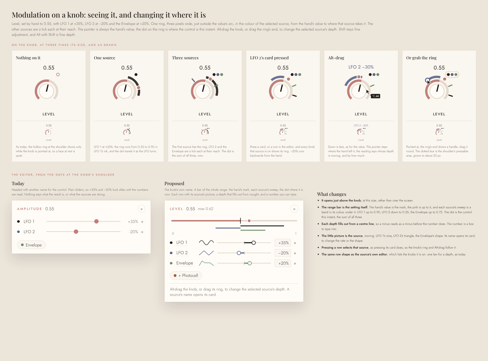
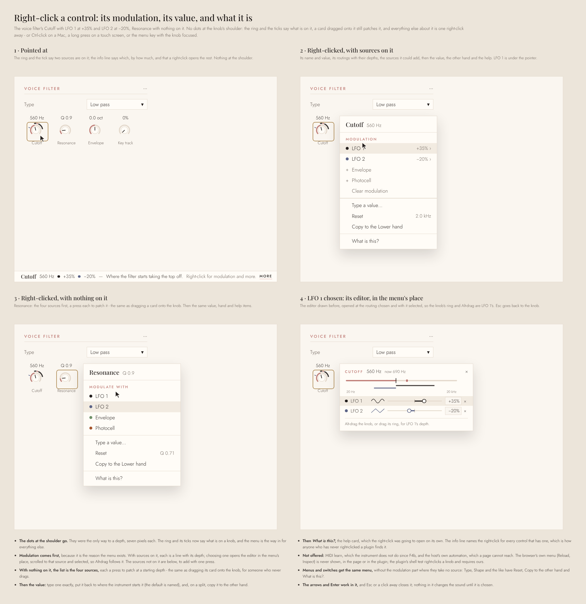
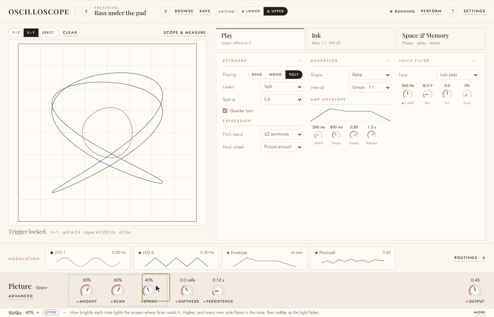
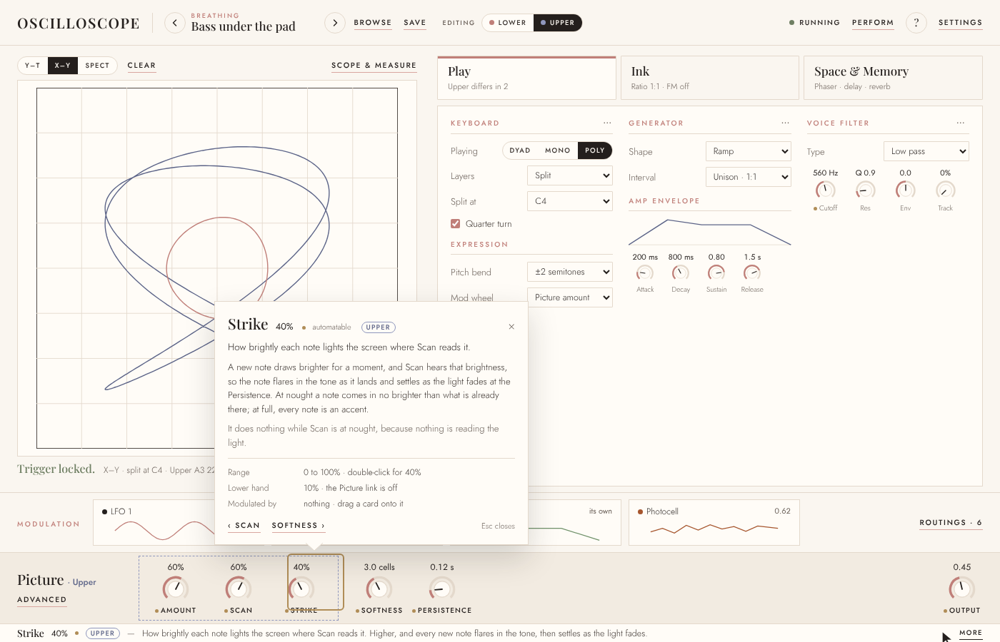

# The face, second pass

A design, built through G6 (see *Stages*). It is the brief for the stage after the reverb: the face's second
pass, agreed with the owner from mockups on 9 November 2026, after the second review
(`second-review.md`, beside this). The first pass is `redesigning-the-face.md`; this one
keeps its rules and changes four things about the face, fixes one bug that is in the
picture rather than the sound, and decides two questions that were open.

The mockups are on the design canvas, *Plugin face layouts*
(<https://claude.ai/artifact/RAFomAR8wVnpHHLxMndTSS>, private to the owner until shared),
in the row headed *Modulation across the window, and each hand's own settings*; the
pictures here are rendered from it. Stages are **G1–G8**.

## What changes, in short

1. **Modulation is a row across the whole window,** under the screen and the tabs, with a
   card per source that draws the source itself, and a *Routings* button in its corner.
2. **The Photocell is a modulation card.** Today it can be switched on but not routed.
3. **Each hand can have its own settings, section by section.** One selector in the header
   says which hand you are editing; a link on each section says whether that section is
   the same in both.
4. **Enlarge** shows the screen on its own, and can show the picture with nothing over it.
5. **Play is rebuilt to the drawing** it was meant to follow, and the rows that drifted
   into it go where they belong.
6. **The drawings are removed** (decided 9 Nov): the harmonograph, the figures, the solids
   and the second generator.
7. **Level becomes the Generator's,** and a master **Output** takes its place in the corner.
8. **The wash is fixed:** the screen's fade stops short of the paper and stains it.

## The face

### The header

The versions *A / B* go: undo (a hundred steps), saved presets and the morph's two
stored sounds already cover comparing, and it was one of three different "A/B"s on the
face. In its place, shown only when *Layers* is *Split* or *Layer*: **Editing: Lower ·
Upper** (or *A · B* when layered), each with its figure's ink. The *Scope / Bench* views
go too; *Enlarge* replaces the Scope view (below), and the panes it showed (goniometer,
spectrum, harmonics, tuner) show beside the screen when they are switched on in the
Picture's Advanced.

### The hands

A **link** on each section's title, shown only with layers on: *Same in both* (closed
chain) or *Upper's own* (broken chain, in that hand's ink).

| Where | Sections with a link |
|---|---|
| Play | Generator, Amp envelope, Voice filter. The Keyboard has none: it is both hands by nature |
| Ink | Oscillator, Shaping |
| Space & Memory | Each module, in place of today's *Together · A · B* switches and B's hidden turn |
| The Picture section | One link for Amount, Scan and Strike. Softness and Persistence stay shared: they are the screen's |

Linked, editing either hand edits both. Unlinking copies the hand you are on into the
other as its start, then they go their own ways. A new split starts with everything
linked. The tab cards' lines say what differs (*Upper differs in 2*). A routing follows
its destination's section: on a linked section it moves both hands, on an unlinked one
the hand you are editing, and its row in the source's editor says which (*Both*, *Upper*,
*Lower*).

This fits what is stored. The schema's twin fields already mean "empty is the same as
A": linked is an empty B value and unlinked an explicit one, so codes that already store
B values load as unlinked and need no migration. New twins: the Picture amount and
Strike. Fields that are always separate today (B's shape, level and the rest) become
twins; their stored values are explicit, so they keep meaning what they meant.

### Space & Memory

The rack as built, with a link on each module beside its arrow, and the reverb as a
module of its own (Mix, Decay, Spread; Spread at 0 keeps the figure, as agreed).

### Modulation

A row across the window under the screen and the tabs: a card per source, each drawing
what it is doing with a dot where it is now, *Drag onto a knob · press to open* at its
left, and **Routings** with its count in the right-hand corner. Under the compact size
the cards fold to chips, each still with a small drawing of its shape.

Four sources: **LFO 1, LFO 2, the Envelope and the Photocell**. The row has room for more,
but the cut from twenty-eight to three happened because forty chips read as a wall, so it
stops at about six, and a source earns a card by acting on the loop. Glow, Motion and
Memory stay off it: they move the sound with nothing routed, and routing them as well
would be a second way to the same thing. CLAUDE.md's *Three modulation sources, a card
each* changes to say so.

A card opens its editor over the tabs, leaving the screen in view. Each draws the source
itself; its right-hand column is always *Where it goes*.

**An LFO:** the wave, large, with a line and a dot where it is now; Shape, Sync and Rate
under it. *Start* (where the wave begins) and *Fade in* are new and optional.

**The Envelope:** *Follows Play / Its own* and *Each phrase / Every note* along the top;
its curve with corners to drag and a dot where the phrase is; the four times under it.
Following Play, the curve is Play's, greyed and set there.

**The Photocell:** what it sees, a close crop of the screen around its reticle; a graph of
its last four seconds; its value now; *On*; and *Place it on the figure*. The reticle
still drags on the screen. *Size* (how much of the screen it reads) and *Smooth* are new
and optional. It keeps the picture's limit: it can move a control at most half way.

**Routings**, from the row's corner (not called Settings, which the header has): every
routing, by source or by destination, each with its depth and ✕, and a switch per source
that silences its routings without losing them. The **fade** moves here from Settings with
its Restart and Loop, as the one setting that acts on every routing.

### Modulation on a knob

Agreed 9 Nov. Today a modulated knob is hard to read and harder to change: the source's
reach is a 1.5-pixel ring against the value's arc (LFO 1's charcoal reads as a smudge on
it), only one source is drawn, the dot for where the control is now is five pixels, and
the only way to a depth is three seven-pixel dots at the shoulder. Its editor is headed
*Amplitude* over a knob named *Level*, and its plain sliders make +35% and −20% look alike.

**On the knob.** One ring, three pixels, a little outside the value's arc, in the
*selected* source's ink, from the hand's value to where that source takes it - backwards
for a negative depth. Every other source on it is a tick in its ink at its reach. The dot
on the ring is where the control is this instant, the sum of them all. The pointer is
always the hand's value, so the knob never swings while it is being turned. The selected
source is the card last pressed (or the editor row), if it is on this knob, and otherwise
the knob's first; pressing a card shows its ring on every knob it is on. The shoulder's
dots go (below): the ring and the ticks say what is on a knob. The cell still measures the
same with nought to three sources (`patchtest.py`).

**Changing a depth where it is.** Alt-drag the knob (Option on a Mac), the standard
Serum set: it moves the selected source's depth, not the value. Shift stays fine
adjustment, as on every knob, and Alt with Shift is fine depth. Or grab the ring: pointed
at, its end shows a handle to drag round. While either moves, the reading above the knob
says whose depth and how much (*LFO 2 −30%*), and the info line says it too.

**The editor** opens just above the knob, from its right-click menu, headed with the knob's own name and value. A
bar of the control's whole range carries the hand's mark, each source's sweep as a band in
its ink, and the dot where it is now. A row per source: its ink, its name (which opens its
card), a small live picture of it, a depth that fills out from a centre line, a number to
type into, and ✕; pressing a row selects that source. Then the sources not on it, as
today, and one line saying Alt-drag. The source's own editor lists its knobs with the
same row, one law for a depth as now.

**The right-click menu**, agreed 9 Nov, replaces the dots at the knob's shoulder, which
were the only way to a depth and seven pixels each. Right-click a control - or Ctrl-click
on a Mac, a long press on a touch screen, the menu key or Shift+F10 with it focused - and
a menu opens beside it, headed with its name and value:

- **Its modulation, first.** With sources on it, each is a line with its ink and depth;
  choosing one opens the editor in the menu's place with that source selected, so the
  ring and Alt-drag follow it. Then the sources not on it, a press each to add, and
  *Clear modulation*. With nothing on it the list is *Modulate with* and the four
  sources, a press each - the same as dragging a card on, for someone who never drags.
- **Its value:** *Type a value…*, *Reset* with the starting value named, and on a split
  *Copy to the Lower hand* (or Upper).
- ***What is this?***, the help card.

Menus and switches (Type, Shape) get the same menu without the modulation part. Not
offered: MIDI learn, which the instrument does not do since F4b, and the host's own
automation, which a page cannot reach. The arrows and Enter work in it; Esc or a click
away closes it, and nothing in it changes the sound until it is chosen. The browser's own
menu (Reload, Inspect) is never shown, in the page or in the plugin's web view, and the
plugin's shell test right-clicks a knob and requires ours. A card dragged onto a knob
still patches it, and the info line names the right-click for every control that has a
menu, which is how anyone who has never right-clicked a plugin finds it.

### The Picture section

Amount, Scan, Strike and the three meters in a group with the hand's link, titled
*Picture · Upper* while you edit the upper hand; Softness and Persistence beside it, under
*The screen, shared*. **Level moves to the Generator** (below), and a master **Output**
takes the corner. *Advanced* keeps what Scan reads, the score and what each hand's picture
moves (from Play); it loses the Photocell switch to the card.

### Level and Output

The Picture section's *Level* has never been a master volume: it is the generator's
amplitude (`amp`, with layer B's `bAmp`), so it is per hand. It moves into the Generator
section, linked with it. The corner gets a true **Output**: one level after everything,
shared by both hands, and new. Host parameters: `level` keeps its id and its meaning (the
generator's level, both hands while linked); `output` is added. No projects are saved
yet, so this costs nothing now.

### Enlarge

A button at the end of the screen's toolbar fills the window with the screen (Esc to come
back), with one switch, **Picture only**, on by default there. It hides everything drawn
over the trace: the photocell's reticle, the loop overlay (Scan's ring, its read-head,
table and badge), the hand's mark, the axis labels, the verdict and readouts, and the
graticule if wanted. All of these are on layers of their own, so hiding them changes
nothing heard. Two choices that only the enlarged view needs, both look-only and labelled
so:

- **Which hands:** *Both · Lower · Upper*. In Crossed hands the two figures and their long
  trails pile into one cloud; one at a time, each can be seen.
- **Trail:** a shorter trail for the display only. It shows less than Scan is reading,
  which a visualiser can accept and the instrument's normal face should not.

## Play, as drawn

The built Play tab drifted from the first brief: Expression went behind the Keyboard's
dots at every size, the amp envelope is four knobs under the Generator with Glide wrapped
beneath Attack (so it reads *Attack off*), the filter's column is empty while it is off,
and the Keyboard holds rows that are not the keyboard's.

Three columns, as drawn:

1. **Keyboard**, then **Expression** on show (pitch-bend range, mod wheel, pressure,
   velocity). On the compact face Expression may fold behind the dots; above it, never.
2. **Generator** (Kind, Shape and its own rows, Interval, Tuning, Level, Glide beside
   Shape), then **Amp envelope** with its curve.
3. **Voice filter**, then its envelope. Off, its controls show greyed, as the drawbars do,
   rather than leaving a third of the tab empty.

At large windows the face grows: the screen to its column's height, and the row and the
verdict under it rather than pinned to the bottom of the window. Menus that are cut off
today (*2 n*, *bass and*, Perform's *1/* and *1 o*) get their room.

## The wash

The screen fades by painting the paper over itself each frame at the persistence's
strength. Below about 0.1 a frame's step is less than half of one 8-bit step before the
paper is reached, so it rounds to nothing and the pixel stops: measured on a bare canvas,
a rose, a slate and a grey trace all stop at grey 220 at Crossed hands' 0.0255 and never
move again, and at 0.12 (Slow pad, Turning fifths, Bass under the pad) a faint stain stays
(248, 248, 240 against the paper's 255, 252, 247). The axis labels are written into the
same canvas every frame (`scope.html:18378`, `:18383`), so a label from before - *Right →*
under *A · X, B · X* - never leaves either: the overlapped wording.

The sound is untouched (Scan reads the phosphor grid, which fades in floating point), but
the screen then shows a picture Scan is not reading. The fix:

1. **The axis labels and the graticule on a layer of their own,** as the loop overlay is.
2. **A fade that reaches the paper:** at low persistence, fade every few frames by the
   equivalent larger step, or keep the trace in a full-precision buffer.
3. **A test against the failure:** paint ink, run ten seconds of fades at 0.0255, and
   require the pixel within 2 of the paper. It fails today; null-test it against the
   current fade before trusting it.

## Removing the drawings

Decided on 9 November, ahead of the date the plan set for it: the owner does not miss
them. Out go the harmonograph, the figures (shapes, text, SVG paths, the drawn figure),
the wireframe solids and the second generator; their rows (Figure, Words, SVG, Draw,
Detail, Solid, Spin X, Y and Z, Spin rate, Perspective, Trace rate, Ring, Swing, Detune,
Energy), their entries in *Kind*, *Input into the generator*'s *Its figure* and *Its
rate*, the drawings' sources, *Play the figure at the note's pitch*, and *Notes play this
generator*, which only chose between them and the waveform. Page and core together, with
parity. Their setup fields go in a **version-10 decode pass on both sides**: a code that
named a drawing as its Kind loads as the waveform, and the fields are dropped. The old
library kept as a corpus holds presets that use them; the suites that open those need
another sound or a skip that says why.

What stays parked is the hearing family: it still runs, and the second review asks for it
to run only when something routes it.

## Where every control goes

| Now | In the second pass |
|---|---|
| Header: A / B (versions) | Removed; *Editing: Lower · Upper* with layers on |
| Header: Scope / Bench | Removed; *Enlarge* on the screen's toolbar |
| The spectrogram's Span | Scope & measure › Time |
| *Looking for* under the screen | Scope & measure, with the readouts |
| Find a control (a box like a tab) | A magnifier at the end of the tab row |
| Keyboard: Edit A / B | Removed; the header's selector |
| Keyboard: Pictures A→A, B→B | Picture › Advanced, beside what Scan reads |
| Keyboard: ⋯ Pitch bend, Mod wheel, Pressure, Velocity | Expression, on show |
| Keyboard: Notes play this generator | Removed, with the drawings |
| Keyboard: Take the lag and the tuner from the note, …and the timebase | Scope & measure |
| Keyboard: on screen, mode, layers, split point, a figure each, Draw, quarter turn, hold the interval, ⋯ tune a chord | Stay |
| Generator: Attack, Decay, Sustain, Release | Amp envelope, its own section with its curve |
| Generator: Frequency, Phase | Ink › Oscillator |
| Generator: the drawings' rows | Removed |
| Generator: Kind, Shape and its rows, Interval, ⋯ Tuning, Glide | Stay, with Level |
| Voice filter (off) | Its controls greyed, not hidden |
| Ink: drawn cycle, drawbars, Oscillator, Shaping | Stay, with Frequency and Phase |
| Rack: Plane's Layers switch and B's turn | Each module's link |
| Rack: everything else | Stays |
| Picture: Amount, Scan, Strike, meters | The hand's group |
| Picture: Softness, Persistence | *The screen, shared* |
| Picture: Level | Generator; a master Output in the corner |
| Advanced: Photocell switch | The Photocell card |
| Advanced: what Scan reads, Score, Loop, Panes, Beam | Stay |
| LFO and Envelope editors | The drawn editors |
| Settings: Modulation fade | Routings |
| Settings: Input into the generator's figure and rate | Removed, with the drawings |
| Settings: MIDI, This window, Input, Audio | Stay |
| Perform: Morph's A / B | Renamed *From / To* |
| Perform: everything else | Stays |

## Saying what a control does

Agreed 9 Nov, over tooltips, a help mode on its own, and today's notes behind each
section's dots. Tooltips cover the neighbours on a face this dense and flicker across a
row of knobs; a mode is something to remember to enter; the notes are about a section,
not the knob under the hand, and nothing says they are there.

**The info line** sits in the Picture section's free middle, between Level's meter and
the three reads, at every size: the control's name, its value, the gold dot if a host can
automate it, the hand it applies to, one plain sentence, and **More**, in two lines at
most. (Drawn first along the foot of the window, and under the screen on the compact
face. Built, the foot took 26 px from the tabs, and at 1100x860 the Space & Memory tab
with the keys, the photocell and a split scrolled by 9; under the screen on the compact
face the column cut every sentence after twenty characters. The Picture section's middle
was empty, is in view in either view, and costs no height.) A control takes the
line once the pointer has *rested* on it for about a third of a second, so crossing the
face on the way to More does not change it; touching a control - a knob turned, a menu
chosen - takes it at once. A switch in Settings turns it off.

**The card** opens from More, from *What is this?* in the control's right-click menu, or
from ? while the window has the keyboard - which a host often keeps,
so ? is not shown on the face. It sits beside the control and is not a mode: nothing dims
and the instrument plays on. The sentence again, a paragraph where one sentence is not
enough, and facts the page fills in itself - the range and what a double-click puts it
back to, the other hand's value, what is modulating it. Arrows step through the section;
Esc or a click away closes it. It replaces the notes behind each section's dots, so
there is one place to read about a control rather than two.

One table of words keyed by control id: a sentence for every control, a paragraph for
the forty or so that need one. A test fails if a control has no sentence, which makes
every later stage write its own; another sweeps the pointer across a row of knobs and
requires the line unchanged, rests on one and requires it changed, and chooses *What is
this?* from one's menu and requires its card, each with its null.

## At the plugin's window

At 1200×680 the row is a line of chips, each with a small drawing, and *Routings* in the
corner; Play's three columns fit with Expression on show and the screen at about 410 px.
`fittest.py`'s five windows hold it.

## Stages

Each leaves the suite green and is pushed alone.

- **G1 The wash.** The labels and graticule on their own layer, the fade that reaches
  the paper, the test that fails today.
- **G2 Remove the drawings.** Page, core, parity, the version-10 pass, the corpus suites.
  Done 10 Nov: about 3,200 lines out of the page and the core, seven suites gone with
  them, and Kind off the face (one choice left).
- **G3 Play as drawn,** and the strays moved (Frequency and Phase to Ink, the scope's
  options to Scope & measure, the pictures' row to Advanced), Expression on show above the
  compact face, the filter greyed, the cut-off menus, the face growing at large windows.
- **G3b Saying what a control does.** The info line, the card, the table of words
  for everything on the face after G3 (read by the owner before it ships), the notes
  behind the dots retired, and the test that every control has its sentence.
- **G4 The header and Enlarge.** Versions A/B and the views out; Enlarge with Picture
  only, which hands and the trail. Built 10 Nov: Which hands is *Both · A · B* until G6
  names the hands, and is offered only while each hand draws a figure; the Trail is a
  menu, *As heard · Half · Short*; Picture only hides the graticule too, with no switch
  of its own (the Graticule switch in the Picture's Advanced still rules the face);
  nothing in Enlarge is remembered past the page. `enlargetest.py` holds it.
- **G5 The modulation row.** Full width, the Photocell card, the drawn editors, Routings
  with the fade; CLAUDE.md's rule rewritten. And modulation on a knob: the ring, the
  ticks and the dot, Alt-drag and the ring's handle, the new editor, and the right-click
  menu in place of the shoulder's dots (with the plugin's shell test for it).
  **G5a built 10 Nov**, the row and what it opens, page only: four cards drawing their
  sources with a dot that moves; the Photocell's card, routable whether or not it is on
  (patching it switches it on), its switch moved from the Picture's Advanced into its
  editor as *On*; the editors drawn and over the tab cards as well as the tabs, an LFO's
  Rate and the Envelope's times as knobs; Routings, by source or destination, with the
  fade moved from Settings (`data-home="routings"`), *Switch all off* and *Clear every
  routing*. Decided where the design was open: the cards fold to chips on any window under
  900 px tall, not only the compact face - the cards are 87 px and the chips 36, and at
  1100x860 Ink was 22 px over and Space & Memory (two layers, the delay open) 36; the
  compact face gave back 26 px of padding and two pixels a rack line. A silence is a way
  of listening, not a field: the setup keeps a silenced source's routings, the instrument
  is told the routings heard, and loading a setup forgets it (so the plugin saves a
  project without a silenced source's routings; a stored silence would be a field the
  core reads too). Not built: dragging the Envelope's corners, the LFO's Start and Fade
  in, the Photocell's Size and Smooth, and the routing rows' *Both / Upper / Lower*,
  which wait for G6's hands. `modrowtest.py` holds it. Modulation on a knob is G5b.
  **G5b built 10 Nov**, modulation on a knob, page, core and plugin: the ring in the
  selected source's ink and backwards for a negative depth, a tick for each other source,
  the dot as the sum; Alt-drag (Shift for fine) and the ring's handle, the reading and the
  info line saying whose depth while it moves; the editor over the knob, named for the
  control, with its bar, a picture of each source and a depth to type; the right-click
  menu (a long press, Ctrl-click, Shift+F10 or the menu key) in place of the shoulder's
  dots, with *Copy to layer B* (or A) on a split until G6 names the hands, and the
  browser's own menu prevented but over a text box; and the info line saying *Right-click
  for modulation and more*. Decided where the design was open: the silence is stored, the
  owner's call, as a list of silenced sources (`modSilent`) beside every routing in `mod`
  rather than a mark on each routing - a silence is a source's, and `mod` keeps its
  grammar, so an older reader plays the routings rather than losing them - and the core
  reads and keeps it (`scope::Matrix::keep`), so the plugin's project keeps a silent
  source's routings; it is a step in undo now. *Reset* names the value from a reading the
  control has shown, never by moving it; *Type a value* is in the reading's own terms
  (*2k*, *330 Hz*), found by moving the control once chosen. A slider that takes a source
  keeps its one lane; the ticks and the handle are a knob's. The plugin's face had been the
  *no web view* message on Linux and macOS since the editor began asking (it asked for
  WebView2 everywhere); fixed, found by the shell test's new right-click.
  `ringtest.py` and the shell test hold it.
- **G6 The hands.** The selector, a link per section, the new twins, routings that follow
  the link, Edit A/B and the modules' layer switches retired.
  **Built 10 Nov**, page, core and plugin: *Editing: Lower · Upper* (*A · B* layered) in
  the header after Save, each hand in its figure's ink, shown only with two hands; a link
  on the Generator, Amp envelope and Voice filter, the Oscillator and Shaping, each rack
  module (short, *Both* or the hand's name, before the arrow) and the Picture section,
  whose title says *· Upper* while it is the hand's own; the tab cards' *Upper differs in
  2*. What is stored: a section is linked while a setup has none of its B fields and the
  hand's own while it has any, as the design has it, so the link is read off the fields
  and never stored; B's voice fields are written only while their section is the hand's
  own; the rack's B fields count only with `bPlane` on, as before, and `bPlane` is written
  while any module is the hand's own. New twins `bPictureAmount` and `bScanStrike`, played
  per hand (the stage's routes at each hand's Amount, a note's light at its hand's
  Strike). A routing has a second depth, the upper hand's (`amountB`), stored beside `mod`
  as `modB` in `mod`'s grammar: additive, so no version bump - a code without it has every
  routing at one depth on both hands, which is what it meant. A routing's rows in the
  source's editor and in Routings say *Both*, *Lower* or *Upper*, one row a hand with a
  depth there. B's time modules each have their own bit in the generator's `timeOwn`, and
  a shared module beside an own one is A's to the sample (`timeShare`). The owner's call
  after it: a section with B fields loads as the hand's own only where one of B's values,
  as restore makes them, differs from A's (or a routing on it has its own depth on the
  upper hand), and linked where every one is A's - so every code from before G6, which
  wrote every B field whatever it held, loads linked wherever the hands were one. The bank
  after it: Bass under the tine piano has its Amp envelope, Voice filter, Oscillator and
  Picture its upper hand's own and its Generator linked (B's sine is A's); Bass under the
  pad its Generator (B's level 40 against 45), Amp envelope, Voice filter and Picture;
  Crossed hands is linked throughout (B's sine, ratio and Scan are A's). Decided where the
  design was open: links are kept while the layers are off, so a split switched off and
  on keeps each hand as it was (a setup that never parted them is linked, which is how a
  new split starts); relinking copies the hand on
  the face over the other, and drops the other hand's own routing depths on the section;
  Frequency, Phase, Glide, Interval and Tuning stay shared, and still hide while the upper
  hand is edited; the Plane's Turn shows the upper hand's own turn in its place while the
  Plane is the upper's own and edited (B's turn on a row of its own went); *Copy to the
  other hand* is offered only on a section that is the hand's own; the expression pedal,
  the wheel or pressure on Picture and a host's Amount or Strike move the hands a hand on
  the knob would (both while linked, the one edited otherwise); and in the plugin a press
  of a link or the selector is kept as a hand that no later hand makes redundant, so a
  project reopens each hand's edits on the hand they were made on. `handstest.py` holds
  it, parity the core's.
- **G7 Level and Output.** Level into the Generator, Output added, the host's `output`.
- **G8 The second review's bugs** not covered above (`second-review.md`). They do not
  wait for G7: the plugin's window size, the delay's line while it is off and the rack's
  memory are small and lose or misplay sound today, so they can go first.

## Open

- **New controls the mockups add:** the LFO's Start and Fade in, the Photocell's Size and
  Smooth. Each is page and core work; none blocks the stage.
- **A fifth or sixth card:** none proposed yet. A third LFO or a stepped random source,
  if one is missed.
- **Which hands and Trail** in the enlarged view: whether either is wanted once Picture
  only exists.
